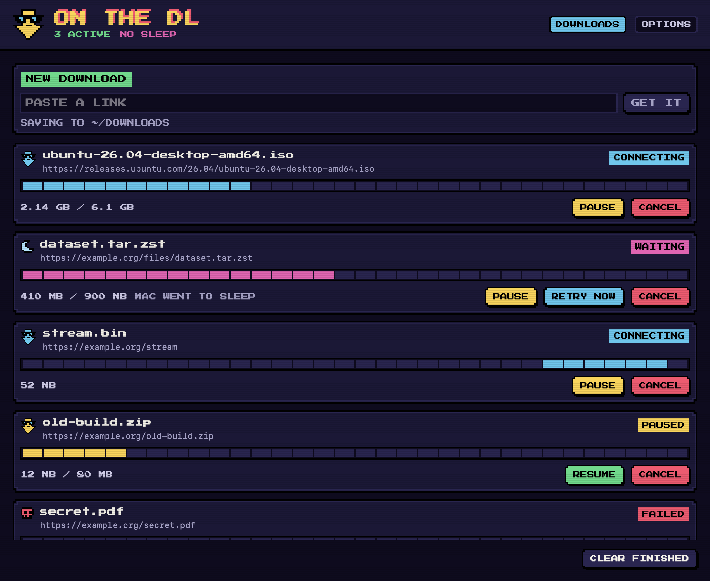

# On The DL

A tiny macOS download manager that doesn't give up when your Mac goes to sleep. Pixel-styled to match [LockDown](https://github.com/zipben/LockDown).



## What it does

- Paste or drop a link (or several, one per line) and hit **GET IT**.
- **Keeps the Mac awake** while anything is downloading (idle sleep only; closing the lid still sleeps). Toggle in OPTIONS.
- **Survives sleep anyway**: connections are closed cleanly before sleep and resumed a few seconds after wake.
- **Resumes, never restarts** when it can: bytes go to `<name>.otdl` beside the final file and continue with HTTP `Range` + `If-Range`. If the server can't resume or the file changed, it starts over cleanly instead of corrupting.
- Retries network failures with backoff (up to 60s), immediately when the network returns, and reconnects connections that stall for 30s.
- Queue is saved to `~/Library/Application Support/OnTheDL/downloads.json`; unfinished downloads pick up on relaunch. Turn on **OPEN AT LOGIN** to survive restarts.
- Uses the server's suggested filename, never overwrites (`file (2).ext`), notifies when done, shows active count on the Dock icon.

## Build

Requires macOS 14+ and the Swift toolchain. No Apple Developer account needed (ad-hoc signed).

```sh
./scripts/build-app.sh        # -> dist/On The DL.app
```

`OnTheDL --render-preview <dir>` writes PNGs of the screens with sample data.

## Credits

Font: [Press Start 2P](https://fonts.google.com/specimen/Press+Start+2P) by CodeMan38, SIL Open Font License (`Resources/OFL-PressStart2P.txt`). Pixel art is original.
